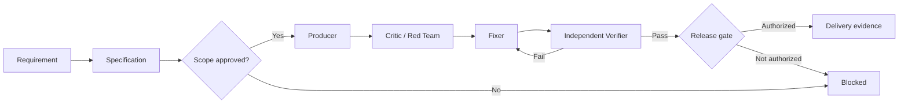

<div align="center">

# Graph Coded Agents SDLC

**From an agent-generated artifact to verified, auditable software delivery.**

A graph-driven engineering control plane for Coded Agents, UiPath automation, and software built with AI coding assistants.

[Quick start](#quick-start) | [Architecture](#architecture) | [UiPath](#uipath-delivery) | [Evidence and cost](#evidence-and-cost) | [Roadmap](docs/roadmap.md)

</div>

---

Graph Coded Agents SDLC brings **engineering governance, explicit verification gates, and persistent execution evidence** to work carried out by AI coding agents. It extends the open-source, MIT-licensed [Graph Harness SDLC](https://github.com/BernydotJar/Graph-harness-sdlc) execution kernel with an application-specific control layer for Coded Agents and UiPath deliveries.

The goal is not to produce more agent activity. **The goal is to deliver working software, with evidence that it works.**

## Core model



The agent is an **interchangeable executor**, not the source of truth. The graph owns the work state, dependencies, quality gates, approvals, and evidence history.

```text
Requirement -> Graph node -> Capability -> Executor -> Evidence -> Gate
```

## What it provides

- **Spec-driven development:** requirements, acceptance criteria, work dependencies, and explicit scope approval.
- **Structured execution:** separate Producer, Critic, Fixer, and Independent Verifier stages.
- **Fail-closed project identity:** verify Git root, repository origin, and expected branch before applying project governance files.
- **Human-in-the-loop gates:** distinguish implementation permission from publish/deploy authority.
- **Persistent evidence:** append-only, SHA-256 hash-chained Graph Harness events, checkpoints, and localized repair.
- **UiPath-specific verification:** distinct gates for Windows Studio/Robot RPA and native UiPath Coded Agent runtime evaluations.
- **Token and USD reporting:** per-attempt model usage, including failed or quota-blocked attempts; cache and thinking tokens remain separately accounted for.
- **Provider-neutral design:** the execution graph is not coupled to one model. Graph Harness includes instruction projections for Claude, Codex, and Gemini.

**Current scope:** this repository provides a reusable **control plane, CLI, graph schemas, and verification contracts**. It does not yet autonomously launch agents, generate complete UiPath applications by itself, or deploy customer automations. Real product scaffolding and execution use their official platform tooling.

## Architecture

```text
Graph Coded Agents SDLC
|
+-- Coded Agents control plane             coded_agents_sdlc/
|   +-- Project identity and safe initialization
|   +-- Platform-aware delivery graph
|   +-- Independent verification checks
|   +-- Per-attempt token and cost accounting
|
+-- Graph Harness execution plane          graph_harness/
|   +-- Typed graph and dependency scheduling
|   +-- Policy, approvals, and quality gates
|   +-- SHA-256 event ledger and checkpoints
|   +-- Repair and resumption semantics
|
+-- Integration surfaces
    +-- UiPath RPA (Studio / Robot on Windows)
    +-- UiPath Coded Agents (SDK / evaluations)
    +-- General-purpose software projects
```

One graph is authoritative for work state. There is no second event store for Coded Agents and no separate policy engine replacing Graph Harness.

## Quick start

**Requirements:** Python 3.11+ and Git. For project initialization, use an **existing Git repository** with a credential-free GitHub `origin`; `--root` must be its actual Git root.

Clone the repository and inspect the CLI:

```bash
git clone https://github.com/BernydotJar/graph_coded_agents_sdlc.git
cd graph_coded_agents_sdlc
python3 -m coded_agents_sdlc --help
python3 -m unittest discover -s tests -v
```

Generate a governance plan for a separate project. This is a **dry run** and does not modify that project:

```bash
python3 -m coded_agents_sdlc init \
  --root /path/to/your-project \
  --project-id remittance-evaluation \
  --repository ExampleOrg/your-project \
  --branch main \
  --platform uipath-rpa \
  --mode MVP --pretty
```

Apply explicitly after checking the expected repository, branch, and changes:

```bash
python3 -m coded_agents_sdlc init \
  --root /path/to/your-project \
  --project-id remittance-evaluation \
  --repository ExampleOrg/your-project \
  --branch main \
  --platform uipath-rpa \
  --mode MVP --apply --pretty

python3 -m coded_agents_sdlc check --root /path/to/your-project --pretty
python3 -m coded_agents_sdlc status --root /path/to/your-project --pretty
```

The initializer creates `.coded-agents/` project contracts, expected identity, a delivery graph, and a scoped policy. It creates `AGENTS.md` **only when missing**. Existing incompatible governance contracts are not overwritten.

A generated project's structure looks like:

```text
your-project/
  AGENTS.md                        # existing instructions preserved
  .coded-agents/
    project.json                   # identity and selected platform/mode
    graph-project.json             # eight delivery nodes and evidence gates
    expected-identity.json         # repository and branch assertions
    policy.json                    # project safety and approval rules
    README.md                      # operating contract
    events.jsonl                   # created on the first recorded event
  <actual application/UiPath source>
```

Use the Graph Harness CLI to inspect and advance the typed graph. An initial graph is **not automatically executed**:

```bash
python3 -m graph_harness \
  --project /path/to/your-project/.coded-agents/graph-project.json \
  --events /path/to/your-project/.coded-agents/events.jsonl \
  status --pretty
```

See [the Graph Harness control-plane documentation](docs/control-plane.md) for approvals, transitions, evidence recording, and gate evaluation.

## Delivery lifecycle

```text
Identity gate
  -> Scope approval
  -> Specification
  -> Producer
  -> Critic / Red Team
  -> Fixer
  -> Independent Verifier
  -> Release gate
  -> Persistent evidence / next ready node
```

The generated graph defines **eight nodes**. An independent verifier is not the same as the agent that produced the artifact. Actor labels can be checked for separation; enterprise-grade identity attestation requires a separate integration.

### Operating modes

| Mode | Primary purpose | Verification |
| --- | --- | --- |
| `MVP` | Constrained delivery of a testable slice | Required graph evidence and independent verification; platform runtime gate when selected |
| `SHIP` | Production-oriented release control | MVP gates plus explicit deployment readback evidence |

All completion claims must match the evidence level: **static analysis != native compilation != runtime execution != deployed customer behavior**.

## UiPath delivery

UiPath RPA projects and UiPath Coded Agents are different products and receive different runtime gates:

| Platform | Artifact built with | Blocking runtime evidence |
| --- | --- | --- |
| `uipath-rpa` | Official UiPath RPA/Studio tooling | `windows_runtime`: validation on Windows Studio/Robot |
| `uipath-coded-agent` | Official `uip codedagent` tooling and SDK | `coded_agent_runtime`: real coded-agent execution/evaluation |
| `generic` | The application's normal toolchain | `independent_verification` |

On Linux, static checks can prove structural correctness, but not Windows compilation or Robot execution. The handoff stays **Windows validation pending** until those tests actually run. Neither UiPath assets nor hosted processes are created by `coded-agents-sdlc init`.

See [UiPath integration](docs/uipath-integration.md).

## Evidence and cost

Every builder attempt matters, including unsuccessful attempts. Import a local Claude Code-compatible JSON result **without copying the transcript into the graph**:

```bash
python3 -m coded_agents_sdlc record-run \
  --root /path/to/your-project \
  --node DEV-PRODUCER \
  --actor builder-fable-5-1 \
  --result-file /secure/local/run-001.json \
  --attempt 1 \
  --builder claude-code --effort xhigh \
  --commit YOUR_ACTUAL_GIT_SHA --pretty

python3 -m coded_agents_sdlc status --root /path/to/your-project --pretty
```

The evidence ledger retains the source-file digest and selected numeric totals, not raw prompts, responses, passwords, or client data. Output, direct input, cache read, and cache creation tokens are recorded separately; **thinking tokens are a subset of output tokens**. Cost is the provider-reported USD estimate, not a reconciled invoice. Duplicate attempts are rejected.

Read [Evidence and cost accounting](docs/evidence-and-cost.md) for the complete contract.

## Verification and safety

```bash
python3 scripts/verify_provenance.py
python3 -m unittest discover -s tests -v
python3 -m compileall -q graph_harness coded_agents_sdlc
```

The published Graph Harness kernel is distributed under its original MIT license. The [provenance manifest](docs/upstream-manifest.json) pins its imported public files to a reproducible source commit. The repository does **not** authorize live customer changes, deployments, credential access, or cloud spending through a passing test or policy check.

## Repository structure

```text
graph_coded_agents_sdlc/
  coded_agents_sdlc/               # Project-specific control layer and CLI
  graph_harness/                   # MIT Graph Harness execution kernel
  schemas/                         # Graph project and event schemas
  skills/                          # Harness engineering skill registry
  templates/                       # Specs and review templates
  tests/                           # Core and adapter regression suites
  scripts/verify_provenance.py      # Public source integrity verification
  docs/                            # Architecture, integration, runbooks
  .github/workflows/test.yml        # Python regression and provenance checks
```

## Guiding principle

> **Autonomy without verifiable state is activity. Autonomy with evidence, gates, and recovery is engineering.**

Graph Coded Agents SDLC is an open project built on [Graph Harness SDLC](https://github.com/BernydotJar/Graph-harness-sdlc). See the [architecture](docs/architecture.md), [roadmap](docs/roadmap.md), and [license](LICENSE) for details.
