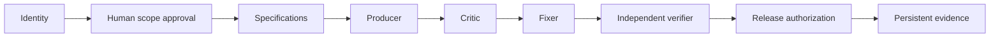

# Architecture: Coded Agents control + Graph Harness execution

The `coded_agents_sdlc` package owns repository identity, non-destructive project initialization, a platform-specific graph contract, and builder cost accounting. The `graph_harness` package remains the **only** event store and gate/scheduler runtime; there is no competing state machine.

The generated 8-node graph does not execute jobs. It requires separately recorded evidence kinds (`identity_preflight`, `scope_contract`, `requirements`, `design`, `build_result`, `critic_review`, `fixer_resolution`, `independent_verification`, `release_authorization`) and enforces dependencies and gate state via Graph Harness. A `GOV-IDENTITY` node can become ready but cannot finish without identity evidence; the `GOV-SCOPE` node requires explicit human approval. A failed node can enter localized repair without deleting event history.

`uipath-rpa` adds a blocking `windows_runtime` gate; `uipath-coded-agent` adds `coded_agent_runtime`; `SHIP` adds `deployment_readback`. These are different from static XAML validation and build checks. Gate data is authoritative only when its evidence accurately represents a performed action. Actor labels used to enforce verifier separation are **not** cryptographic identification or SSO.

The CLI `coded-agents-sdlc check` fails if Git root/origin/branch disagree with the contract, the generated graph is changed without review, the event SHA-256 chain is invalid, or a completed independent verifier shares an actor label with the Producer/Critic/Fixer. The policy subsystem requires explicit approval for destructive/external operations and cannot turn denied paths into allowed actions via preferences.

Further scope: real provider execution orchestration, enterprise actor attestation, live UiPath tenant adapters, Windows build/test automation and Excel export are planned; they are not part of v0.1.
